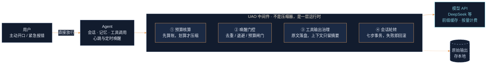

[English](ARCHITECTURE.md) | [简体中文](ARCHITECTURE.zh-CN.md)

# Universal Agent Optimizer Architecture

This specification defines the evolution of **Universal Agent Optimizer** from a single-project utility into an independent, extensible, general-purpose Agent Runtime Optimization Middleware.

---

## 1. Layered Architecture

```text
+-----------------------------------------------------------------------+
|  1. Integration Layer (Embedded SDK Adapters / Local HTTP Proxy)      |
|     OpenAI-Compatible | Anthropic | LangGraph | MCP | Custom Agent    |
+-----------------------------------+-----------------------------------+
                                    |
                                    v
+-----------------------------------------------------------------------+
|  2. Core Optimization Engine (Zero Required External Dependencies)    |
|     - Invocation Controller (Opt-4: Coalesce / Cooldown / UrgentPass) |
|     - Session Lifecycle Controller (Opt-1: 7-Step Safe Rotation)      |
|     - Static Context Dedup (Opt-3: Session Fingerprint & SubBlocks)   |
|     - Context Selector & Scope ACL (Fail-Closed Visibility + Budget)  |
|     - Tool Schema Governance & Turn Guard (Opt-2 + Opt-5)             |
|     - Cache Economics Engine (Observed vs Estimated Net Savings)      |
+-------------------+-------------------------------+-------------------+
                    |                               |
                    v                               v
+---------------------------------------+  +----------------------------+
|  3. Plugin Layer (Optional, Isolated) |  | 4. Observability Layer     |
|     - Single-Compressor Coordinator   |  |    - Universal TokenLedger |
|     - ToolResultRetention / Recovery  |  |    - CostTracker           |
|     - External Optimizers (Circuit    |  |    - CacheTracker          |
|       Breaker: Headroom/RTK/CC/LLML)  |  |    - AuditLog              |
|     - StateProvider (Noop / Companion)|  +----------------------------+
+-------------------+-------------------+
                    |
                    v
+-----------------------------------------------------------------------+
|  5. Provider Layer                                                    |
|     DeepSeek | OpenAI | Anthropic | Gemini | Local LLM | LiteLLM      |
+-----------------------------------------------------------------------+
```

---

## 2. Operating Modes (Embedded vs. Proxy)
### Runtime Request Flow — UAO Middleware Position



### 1. Embedded Mode (In-Process Library)
- **Best for:** Custom Node.js / Python agents, LangGraph nodes, and agent runtimes that own their own memory and control loops.
- **Advantages:** Full lifecycle control—run `beforeWake()` (Opt-4) prior to model wakeups, `prepareRequest()` (Opt-1 / Opt-3 / ContextSelector) during assembly, `manageToolResult()` inside tool loops, and `afterResponse()` for telemetry.
- **Entry point:** `new UniversalAgentOptimizer(config)`.

### 2. Proxy Mode (Zero-Intrusion Local HTTP Proxy)
- **Best for:** Claude Code, OpenClaw, Codex, and existing OpenAI/Anthropic SDK apps (zero code changes—only override `BASE_URL`).
- **Endpoints:**
  - `POST /v1/chat/completions` (OpenAI / DeepSeek / LiteLLM compatible)
  - `POST /v1/messages` (Anthropic Messages API compatible)
  - `GET /health`, `GET /metrics` (ledger & cache telemetry)
- **Honest Capability Boundary:** Transparent HTTP proxy handles **Tool Governance, Tool Result Retention, Static Block Dedup, Cache Economics, and Cost Ledger**. However, **autonomous wake suppression (Opt-4)** and **host memory flushing (Auto-Flush)** require host cooperation via SDK calls or webhook hooks, because a pure HTTP proxy cannot predict host timer intent before a request is sent.

---

## 3. Core Interface Contracts

### 1. Adapter API (`AgentAdapter`)
Every agent runtime integrates with the core engine via a unified contract:

```ts
export interface OptimizationContext {
  agentId: string;
  sessionId: string;
  conversationKey: string;
  provider: 'openai' | 'anthropic' | 'deepseek' | 'gemini' | 'local' | 'litellm' | string;
  model: string;
  turn?: number;
  messages: Array<Record<string, unknown>>;
  tools?: Array<Record<string, unknown>>;
  staticBlocks?: Record<string, string>;
  metadata?: Record<string, unknown>;
}

export interface AgentAdapter {
  readonly name: string;
  onWakeCheck?(trigger: WakeTriggerEvent): Promise<WakeDecision>;
  beforeRequest(ctx: OptimizationContext): Promise<OptimizedRequest>;
  onToolResult?(toolCall: ToolCallInfo, rawResult: unknown): Promise<ManagedToolResult>;
  afterResponse(ctx: OptimizationContext, response: NormalizedModelResponse): Promise<void>;
  onSessionRotate?(rotationCtx: RotationContext): Promise<RotationOutcome>;
}
```

### 2. Plugin API (`CompressionPlugin` & Single-Compressor Coordinator)
**Anti-Double-Compression Hard Constraint:**
- A given content block (tracked via `contentHash` + `stage`) is compressed by **at most one lossy compressor** within a single request cycle.
- When `HeadroomPlugin`, `ContextCompressPlugin`, or `RTKPlugin` are registered together, the **Single-Compressor Coordinator** routes by content type (`structured_json -> Headroom`, `cli_log -> RTK`, etc.) and tags outputs with `_compressedBy` to prevent re-compression.
- All external plugins are wrapped with a **Circuit Breaker + Quality/Cost Gate**: if the external service is unavailable, times out, or produces `predictedCostAfter > baselineCost` or `qualityScore < minQualityScore`, it immediately falls back to `originalContent`.

```ts
export interface CompressionPlugin {
  readonly name: string;
  readonly supportedContentTypes: Array<'tool_output' | 'rag_chunk' | 'history' | 'cli_log'>;
  isAvailable(): Promise<boolean>;
  compress(input: {
    content: string;
    contentType: string;
    budgetTokens?: number;
    preservePrefix?: boolean;
  }): Promise<{
    ok: boolean;
    content: string;
    compressedBy?: string;
    originalRefId?: string;
    qualityScore?: number;
    fallbackReason?: string;
  }>;
}
```

### 3. State Provider API (`StateProvider`)
The universal core has zero hard dependency on persona, emotion, or companion-relationship state:

```ts
export interface StateProvider {
  readonly name: string;
  getContextSignals(scope: { conversationKey: string; now: number }): Promise<{
    promptHints?: string[];
    priorityBoostById?: Record<string, number>;
    invocationBias?: number; // clamped, e.g. [-0.05, 0.05]
  }>;
  onBeforeSessionRotate?(handoffPayload: {
    conversationKey: string;
    fromSessionId: string;
    recentMessages: Array<unknown>;
  }): Promise<{ flushed: boolean; verificationToken?: string }>;
  onRecordsSelected?(records: Array<unknown>, scope: { now: number }): Promise<void>;
}
```
- **Default:** `NoopStateProvider` (returns empty signals and `flushed: true`).
- **Optional Reference:** `CompanionStateProvider` (wraps legacy `emotion-state.js` and `memory-reconsolidation.js` for companion agents).

---

## 4. Repository Layout & Backward Compatibility

To preserve full compatibility with legacy `Opt-1 ~ Opt-5` import paths while clean-layering v2:

```text
src/
├── core/
│   ├── model-prices.js            # Multi-provider pricing & usage normalization
│   ├── cache-economics.js         # Cache-Aware Cost Model & Net Savings gate
│   ├── session-lifecycle.js       # Opt-1: 7-step transactional rotation + rollback
│   ├── tool-governance.js         # Opt-2: Scene schema pruning & jitter detection
│   ├── static-context-dedup.js    # Opt-3: Generic static & sub-block fingerprint dedup
│   ├── invocation-controller.js   # Opt-4: Priority bypass + dedup + exponential backoff
│   ├── tool-output-retention.js   # Lossless tool result retention & line/keyword recovery
│   ├── context-selector.js        # Universal context selection + Fail-Closed Scope ACL
│   └── optimizer.js               # UniversalAgentOptimizer orchestrator
├── adapters/
│   ├── base.js
│   ├── openai-compatible.js
│   ├── anthropic.js
│   ├── mcp.js
│   ├── langgraph.js
│   └── custom-agent.js
├── plugins/
│   ├── compression.js             # Single-Compressor Coordinator + Quality Gate
│   ├── state-provider.js          # StateProvider interface + Noop + Companion
│   └── external-optimizer.js      # Headroom / context-compress / RTK + CircuitBreaker
├── observability/
│   ├── token-ledger.js
│   ├── cost-tracker.js
│   ├── cache-tracker.js
│   └── audit-log.js
├── proxy/
│   └── server.js                  # Zero-dependency HTTP transparent proxy
└── (legacy root modules preserved for backward compatibility)
```
