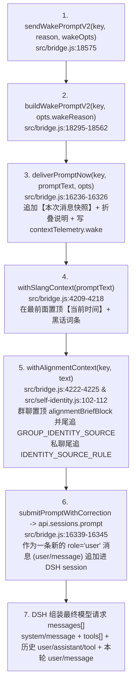

[English](CONTEXT_ASSEMBLY_MAP.en.md) | [简体中文](CONTEXT_ASSEMBLY_MAP.md)

# 本人 Agent 上下文组装全链路图与真实请求映射 (`CONTEXT_ASSEMBLY_MAP.md`)

## 1. 部署基线与文件指纹（只读审计快照）

- **审计时间**：`2026-11-12T00:03:00Z`（`Europe/London` 同为 `00:03:00`）
- **生产主机与路径**：`ubuntu@130.162.165.68:/home/ubuntu/surfcore`
- **版本说明**：`/home/ubuntu/surfcore` 为非 `.git` 部署目录（`package.json` 版本号 `0.8.8`），以目标文件 SHA-256 哈希作为精确版本锚点：

| 文件路径 | SHA-256 | 行数 / 说明 |
|---|---|---|
| `/home/ubuntu/surfcore/src/bridge.js` | `5effa20ff102cafec0e1c30a72b0651b3abb61f7ef71c35a2791733abd31d333` | `22,718` 行，主桥接进程（`PID 182413`） |
| `/home/ubuntu/surfcore/config.json` | `3006c362676d106e2bad29493bdf477eeeab82200cb8a673a319b4cb8c4cca45` | 生产运行配置 |
| `/home/ubuntu/surfcore/dsh/agent-presets/qq-chat-v2/agent.cordis.yml` | `3f20f1a2c86ed550997f14732ae5a1b898f4906d54f2a9ca554048fc79299cb0` | 二代 QQ 预设与 `compaction` 配置 |
| `/home/ubuntu/surfcore/plugins/surfcore/qq-tool-restrict.mjs` | `1e863ab66a0f3057c0091af092e40887e97b8dd5d4bfed941628359d1d53d505` | DSH `agent/Instruction` 与 `agent/Tool` 注入插件 |

---

## 2. 完整上下文组装调用链（解答评审文档 2.1 节问题 1～5）

### 2.1 从唤醒触发到模型 API 请求的 7 步链路



### 2.2 逐层源码位置与实际行为核实

#### (1) DSH 会话创建与 `system/message` 构造（每会话仅首轮生成一次）
- **会话创建入口**：`ensureSession(key, mode)`（`src/bridge.js:12217-12253`）：
  ```js
  const created = await api.sessions.create({
    cwd: AGENT_WORKDIR, // /srv/agent/data/state/agents
    agentPreset: presetForMode(effectiveMode), // reserved2 -> 'qq-chat-v2'
  });
  ```
- **`system/message` 组成**（写入 `session.v4.jsonl.zstd` 的 `seq:2`，`firstSystemMsgLen = 14,775` JSON 字符）：
  1. DSH 宿主内置系统提示词与安全执行策略。
  2. `dsh/agent-presets/qq-chat-v2/agent.cordis.yml`（第 `42-73` 行）的 `<qq-chat-v2-instructions>`（约 `1,250` 字符）。
  3. `plugins/surfcore/qq-tool-restrict.mjs`（第 `125-128` 行）通过 `ctx.effect()` 注册的 `agent/Instruction`：
     - `QQ_V2_PROMPT`（第 `58-87` 行）
     - `SELF_RESTART_GUARD`（第 `91-97` 行）
     - `AUTONOMOUS_DATA_RULE`（第 `103-112` 行）
  4. MCP 工具 Schema 定义数组（记录在 `request/header` 的 `tools[]` 中，包含 `mcp__snowluma__*`、`mcp__memory__*`、`mcp__memory-book__*`、`mcp__bili-bridge__*`、`mcp__fs-safe__*`、`mcp__web-search-safe__*` 等）。
  - **关键事实**：`system/message` + `tools[]` 共占用约 **`39,296` Tokens**（由 Turn 95 Step 2 Compaction 后的 `cacheHit: 39,296` 精确锚定），在单会话全生命周期内 `100%` 固定在 `messages[0]`，**从未在每轮重建**。

#### (2) `buildWakePromptV2(key, reason)` 构造 `base` + 唤醒原因尾段（`src/bridge.js:18295-18562`）
- 在 `src/bridge.js:18494` 中，`base` 由 **40 个局部变量**按固定顺序直接字符串拼接而成（其中前 3 个变量 `commitmentLine`、`resumeLine`、`startupLine` 未单独拆入 `lastWakePromptMeta` 字典，但包含在 `lastWakePromptMeta.base` 总长度中）：
  ```js
  const base =
    commitmentLine + resumeLine + startupLine +
    roleLine + identityLine + conversationLine + groupSpeechLine +
    versionLine + provenanceLine + adminLine + biliLine +
    memoryCardLine + memoryBookLine + affinityLine + voiceLine +
    tokenLine + initialPromptLine + whatsNewLine + antiAiLine +
    styleLine + emotionLine + hygieneLine + strategyLine +
    dynamicsLine + selfAwarenessLine + proactiveLine + autonomousLine +
    ownerCrossSessionLine + ownerSleepAutonomyLine + closureLine +
    stickerLine + stickerMatchLine + replyLine + statusLine +
    wakeLine + memoryLine + participationLine + fishGuardLine +
    tokenGuardLine + preSleepLine;
  ```
- 随后在 `18535-18561` 行，根据 `reason`（`bootstrap` / `timeout` / `replyCheck` / `proactiveCheck` / `autonomous` / `history` / `backlog` / `poke` / 默认消息唤醒）拼接 `【唤醒】${key}\n原因：...` 指导段。

#### (3) `deliverPromptNow` 拼接消息快照并记录 `contextTelemetry.wake`（`src/bridge.js:16264-16326`）
- 在 `16265-16276` 行，若 `opts.wakeSnapshot` 存在，直接向 `promptText` 尾部追加：
  1. `\n\n【本次消息快照】\n${JSON.stringify(opts.wakeSnapshot)}\n以上消息已提供，无需再调用 qq_get_context_snapshot 获取同批消息；长消息或图片见 truncated / hasImage 标记，按需用对应工具展开。`
  2. `wakeFoldedNoticeV2(opts.wakeSnapshot.folded)`（若有折叠未读消息）
  3. 离线补历史提示（若 `historyCount > 0`）
- **遥测采样点注意（解答评审文档 2.1 问题 2）**：
  - `contextTelemetry.wake` 在第 `16298` 行记录 `promptChars: promptText.length` 和 `layers: { ...lastWakePromptMeta, prompt: promptText.length, snapshot: snapshotChars }`。
  - 此时**尚未执行**第 `16329` 行的 `withAlignmentContext(key, withSlangContext(promptText))`！
  - 因此实际投递进 DSH `user/message` 的字符数比 `contextTelemetry.wake.promptChars` 多出：
    - `withSlangContext` 置顶的 `【当前时间】...`（`32` 字符）+ 黑话块（启用时）；
    - `withAlignmentContext` 置顶的 `alignmentBriefBlock()`（仅 `group:*` 且文件非空时）+ 尾追的 `IDENTITY_SOURCE_RULE`（私聊 `144` 字符）或 `GROUP_IDENTITY_SOURCE`（群聊 `117` 字符）。

#### (4) `withSlangContext` 与 `withAlignmentContext` 的最终包装（`src/bridge.js:4209-4225`, `16329`）
- **`withSlangContext(promptText)`**（`src/bridge.js:4209-4218`）：
  - 在 `promptText` **最顶端（offset `0`）**插入：
    `【当前时间】${now.toLocaleString('zh-CN', { hour12: false })}（${Intl.DateTimeFormat().resolvedOptions().timeZone}）`
  - 若 `cfg.slang?.enabled !== false`，紧随其后插入 `buildSlangContext(slangEntries, cfg.slang?.injectMax ?? 8)`。
- **`withAlignmentContext(key, text)`**（`src/bridge.js:4222-4225` -> `src/self-identity.js:102-112`）：
  - **私聊（`private:*`）**：调用 `wrapPrivateIdentityPrompt(key, text)`，在**最末尾**追加 `\n\n` + `IDENTITY_SOURCE_RULE`（`【身份来源】你的名字以【你的身份】为准...`，`144` 字符）。
  - **群聊（`group:*`）**：调用 `wrapGroupIdentityPrompt(key, text, alignmentBriefBlock())`：
    - 若 `state/qq-alignment-brief.txt` 非空，将其置顶在 `【当前时间】` **之前**；
    - 在**最末尾**追加 `\n\n` + `GROUP_IDENTITY_SOURCE`（`【群聊身份来源】你在群里的昵称以【你的身份】为准...`，`117` 字符）。

#### (5) 唤醒未提交配置时的提醒补发路径：`buildWakeReminderPromptV2(key)`（`src/bridge.js:18564-18573`, `21417`）
- 当某个 Turn 结束（`turn/end`）但模型未调用 `qq_set_wake_config` / `qq_mark_read` / `qq_close_conversation` 且无未读消息时，`bridge.js:21417` 会调用 `deliverPrompt(key, buildWakeReminderPromptV2(key))`。
- 注意：`buildWakeReminderPromptV2(key)` 也会再次拼接 `${roleLine}${identityLine}${conversationIdentityLineV2(key)}${groupSpeechLine}${tokenLine}【提醒】...`（约 `5,200` 字符）并经过 `withAlignmentContext(key, withSlangContext(...))` 投入同一会话历史。

---

## 3. 真实请求级组装明细与段落偏移表（私聊 1 条 + 群聊 1 条）

以下两条 Trace 直接提取自线上 `/srv/agent/data/state/context-telemetry-bridge.jsonl` 与对应的 DSH 会话文件 `/home/ubuntu/.dsh/sessions/--srv-agent-data-state-agents--/<sessionId>/session.v4.jsonl.zstd`。

### 3.1 私聊真实 Trace：`private:1587592535`（`wakeId: w_1794440287561_3`，Turn 95）

- **会话 ID**：`session-5d062d1c-b11c-4cec-869f-7db1148cf4e0`
- **唤醒时间**：`1794440287564`（`2026-11-11 23:38:07 UTC`）
- **唤醒原因**：`reason = "owner"`
- **遥测记录长度（包装前）**：`promptChars = 16,866`（其中 `base = 14,728`，`snapshot = 1,622`）
- **DSH `user/message` 落盘总长度（包装后）**：`17,042` 字符（`= 16,866 + 32 [当前时间+换行] + 144 [身份来源尾注]`）
- **Step 1 模型调用 (`ts: 1794440292482`)**：
  - `cacheHit = 214,656` Tokens
  - `cacheMiss = 9,620` Tokens
  - `output = 521` Tokens
  - `totalTokens = 224,797` Tokens

#### 私聊 `user/message` 内 55 个段落的真实顺序与字符偏移（提取自 `session-5d062d1c...v4.jsonl.zstd`）

| 序号 | 段落标题 (`【...】`) | 对应源码变量 / 函数 | 起始 Offset | 段落字符数 | 归属层级 |
|---:|---|---|---:|---:|---|
| 1 | `【当前时间】` | `withSlangContext` (`bridge.js:4210`) | `0` | `32` | C（每轮动态） |
| 2 | `【承诺记录（来自桥接账本，不是你的记忆）】` | `commitmentLine` (`commitment-ledger.js:126`) | `32` | `46` | C（按需动态） |
| 3–8 | `【当前角色】` / `【身份底座】` / `【人格核心】` / `【人格语气】` / `【场景人格｜QQ 私聊】` / `【人格日常】` | `roleLine` (`personaWakeBlockV2` -> `roleHintForMode`, `bridge.js:16827`) | `78` | `4,692` | B（会话/角色版本锚定） |
| 9 | `【你的身份】` | `identityLine` (`selfIdentityTextV2`, `self-identity.js:55`) | `4,770` | `179` | B（配置版本锚定） |
| 10 | `【当前会话】` | `conversationLine` (`conversationIdentityLineV2`, `bridge.js:16815`) | `4,949` | `32` | B（会话级锚定） |
| 11 | `【版本】` | `versionLine` (`versionWakeBlock`, `bridge.js:16998`) | `4,981` | `68` | B/C（升级首轮含 changelog，余轮固定 68 字） |
| 12–13 | `【来源判断】` + `【只用于自己】` | `provenanceLine` (`provenanceRuleLine`, `bridge.js:18313`) | `5,049` | `382` | A/B（纯静态规则文案） |
| 14 | `【长期称呼偏好｜QQ】` | `adminLine` (`adminPromptLine(true)`, `owner-addressing.js:13`) | `5,431` | `501`（含称呼块） | B（配置/称呼状态锚定） |
| 15–23 | `【15分】`..`【看过】`（B站品味与近期观看） | `biliLine` (`biliPreferenceWakeLine`, `bridge.js:18315`) | `5,932` | `1,091` | B（B站同步周期锚定） |
| 24 | `【记忆卡 · 你自己的记忆】` | `memoryCardLine` (`memoryCardPromptBlock`, `bridge.js:16714`) | `6,720` | `2,176` | C（随记忆卡读写与打分变化，本会话出现 22 种长度） |
| 25 | `【核心记忆】` | `memoryBookLine` (`memoryBookWakeLine`, `bridge.js:18322`) | `8,896` | `537` | C（随当前对话 query 动态检索，本会话出现 9 种长度） |
| 26 | `【语音状态】` | `voiceLine` (`voiceStatusLine`, `bridge.js:16696`) | `9,433` | `148` | B（语音配置与音色库数量锚定） |
| 27 | `【会话令牌】` | `tokenLine` (`st.agentToken`, `bridge.js:18317`) | `9,581` | `77` | B（会话状态锚定，重置时轮转） |
| 28 | `【反AI味】` | `antiAiLine` (`antiAiFlavorLine`, `bridge.js:18332`) | `9,658` | `56` | A/B（纯静态规则文案） |
| 29 | `【聊天方式】` | `styleLine` (`naturalStyleHint`, `bridge.js:18335`) | `9,714` | `169` | C（含对话轮次/场景分支，本会话出现 4 种长度：`169/82/80/66`） |
| 30 | `【状态观察】` | `emotionLine` (`emotionStore.promptBlock`, `bridge.js:18480`) | `9,883` | `57` | C（按需情绪提示） |
| 31 | `【别把聊天做成结案】` | `hygieneLine` (`chatHygieneHint`, `bridge.js:18336`) | `9,940` | `212` | C（按需触发，本会话出现 `212/67` 两种长度） |
| 32 | `【这次怎么接】` | `strategyLine` (`responseStrategyHint`, `bridge.js:18337`) | `10,152` | `50` | C（每轮按最后消息动态计算） |
| 33 | `【这轮怎么说】` | `dynamicsLine` (`turnDynamicsHint`, `bridge.js:18338`) | `10,202` | `102` | C（每轮按消息节奏动态计算） |
| 34 | `【积极性】` | `proactiveLine` (`proactiveEngagementLine`, `bridge.js:18341`) | `10,304` | `142` | B（会话内恒定 `142` 字符） |
| 35 | `【跨会话发送】` | `ownerCrossSessionLine` (`bridge.js:18345`) | `10,446` | `480` | B/C（仅主人私聊，随群白名单变化：`438/480`） |
| 36 | `【主人提议休息时的自主决定】` | `ownerSleepAutonomyLine` (`bridge.js:18367`) | `10,926` | `166` | C（仅当主人消息命中休息正则时出现） |
| 37 | `【对话收尾判断】` | `closureLine` (`closurePromptLineV2`, `bridge.js:15022`) | `11,092` | `597` | C（每轮含实时静默秒数与收尾信号，本会话 30 种长度） |
| 38 | `【表情包策略：像真人一样用，不刷屏】` | `stickerLine` 前半段 (`buildStickerStrategyHint`) | `11,689` | `169` | B（纯静态策略文案 `169` 字符） |
| 39–42 | `【可用表情包】` + `【表情匹配】` | `stickerLine` 后半段 (`buildStickerContext`, `924` 字) + `stickerMatchLine` | `11,858` | `924` | C（受 `recentlyUsedIds(key)` 影响，发表情后变化，本会话 6 种长度） |
| 43 | `【首回复节奏】` | `replyLine` (`replyTimingV2`, `bridge.js:16760`) | `12,782` | `194` | B/C（随配置微调 `194/195`） |
| 44 | `【此刻状态】` | `statusLine` (`bridge.js:18447`) | `12,976` | `68` | C（每轮动态：模式、未读数、上次发言距今分钟） |
| 45 | `【当前唤醒】` | `wakeLine` (`bridge.js:18448`) | `13,044` | `36` | C（每轮唤醒方式与条件） |
| 46–47 | `【进行中的话题】` + `【对群友的印象】` | `memoryLine` (`formatMemoryV2(st)`, `bridge.js:14988`) | `13,080` | `1,103` | C（含 `X分钟前` 与 `互动 N 次`，每轮递增，本会话 12 种长度） |
| 48 | `【参与度参考】` | `participationLine` (`formatParticipationV2`, `bridge.js:14957`) | `14,183` | `72` | C（每轮统计最近发言占比，本会话 15 种长度） |
| 49 | `【Token 防爆破】` | `tokenGuardLine` (`bridge.js:18456`) | `14,255` | `131` | C（含今日发送计数与触发冷却提示，本会话 3 种长度） |
| 50 | `【沉睡前强制等待】` | `preSleepLine` (`bridge.js:18468`) | `14,386` | `374` | B（会话内恒定 `374` 字符） |
| 51–52 | `【唤醒】` + `【行动前】` + `【引用：只在必要时用】` | `buildWakePromptV2` 默认尾段 (`bridge.js:18561`) | `14,760` | `516` | C（随 `reason` 分支变化） |
| 53 | `【本次消息快照】` | `deliverPromptNow` (`bridge.js:16266`) | `15,276` | `1,622` | C（每轮 JSON 快照） |
| 54 | `【身份来源】` | `wrapPrivateIdentityPrompt` (`self-identity.js:102`) | `16,898` | `144` | B（私聊固定尾注 `144` 字符） |

---

### 3.2 群聊真实 Trace：`group:588475979`（`wakeId: w_1794440688264_4`，Turn 38）

- **会话 ID**：`session-e70da340-3859-4445-adcc-7cc0f78c35d9`
- **唤醒时间**：`1794440688272`（`2026-11-11 23:44:48 UTC`）
- **唤醒原因**：`reason = "poke"`
- **遥测记录长度（包装前）**：`promptChars = 12,490`（其中 `base = 10,958`，`snapshot = 1,014`）
- **DSH `user/message` 落盘总长度（包装后）**：`12,641` 字符（`= 12,490 + 32 [当前时间] + 2 [换行] + 117 [群聊身份来源尾注]`；当前 `state/qq-alignment-brief.txt` 为空故顶部未额外增加字符）
- **Step 1 模型调用 (`ts: 1794440692118`)**：
  - `cacheHit = 115,584` Tokens
  - `cacheMiss = 7,170` Tokens
  - `output = 304` Tokens
  - `totalTokens = 123,058` Tokens

#### 群聊与私聊组装的关键差异（实测对比）
1. **`roleLine` 长度不同**：群聊 `roleLine = 5,076` 字符（注入 `【场景人格｜QQ 群聊】` `915` 字符，且受 `OWNER_ALLOW_FILE` 中 `control.groupPersona` 与 `OWNER_GROUP_PERSONA_FILE` 控制）；私聊 `roleLine = 4,692` 字符（注入 `【场景人格｜QQ 私聊】` `531` 字符）。
2. **`groupSpeechLine` 仅群聊存在**：`【主人给本群的发言规则】`（本轮 `147` 字符，全会话出现 `42/147/157/178/204` 共 5 种长度）。
3. **记忆与跨会话隔离**：
   - 群聊中 `memoryCardLine` 仅注入 `shared` 槽位（`503` 字符 vs 私聊 `2,176` 字符）；
   - 群聊中 `memoryBookLine = 0`（`memoryBookWakeLine` 仅在允许的场景注入）、`ownerCrossSessionLine = 0`、`ownerSleepAutonomyLine = 0`、`memoryStatus = 0`。
4. **首尾身份对齐包装不同**：群聊调用 `wrapGroupIdentityPrompt`，顶部支持 `alignmentBriefBlock()`，尾部追加 `【群聊身份来源】`（`117` 字符）。

---

## 4. 关键架构验证问答汇总（对应评审文档 2.1 节）

| 问题编号 | 评审问题 | 实测与源码验证结论 |
|---|---|---|
| **2.1-Q1** | DSH 会话中 System Prompt 与 `buildWakePromptV2` 的关系？ | **完全分离**：System Prompt 在 `api.sessions.create` 时由 `agent.cordis.yml` + `qq-tool-restrict.mjs` 生成一次，固定在 `messages[0]`；而 `buildWakePromptV2` 的产物在每次唤醒时通过 `api.sessions.prompt({ sessionId, mode: 'queue', content })` 作为**一条全新的 `user/message`** 追加到会话历史末尾。 |
| **2.1-Q2** | `withSlangContext` 和 `withAlignmentContext` 在哪一层包上去？ | 在 `deliverPromptNow` 第 `16329` 行（`contextTelemetry.wake` 记录之后、`api.sessions.prompt` 调用之前）包在 `promptText` 最外层。`withSlangContext` 将 `【当前时间】` 置顶在 `user/message` 的 `offset 0`。 |
| **2.1-Q3** | 同一 `sessionId` 多轮唤醒时，`buildWakePromptV2` 的静态块是否真的作为新的 `user/message` 永久留在会话历史里？ | **100% 证实**：在 `session-5d062d1c...v4.jsonl.zstd` 中，每次唤醒都新增一条 `12,672～19,059` 字符的 `user/message`（均值 `16,011` 字符），直到触发 DSH Compaction 前，每一轮的静态块都完整滞留在历史 `messages[]` 中。 |
| **2.1-Q4** | 当 DSH 对会话做 Compaction 时，最早轮注入的 `user/message` 会不会被压缩或裁掉？ | **会被压缩裁掉（已由 `seq:7800-7806` 实测证实）**：DSH 在 `compaction/summary`（`seq:7802`）后，用一条 `<compacted-summary>`（`seq:7803`）+ `Current runtime context`（`seq:7806`）替换掉早期的原始 `user/message` 序列。因此若采用「会话首轮注入 `[SESSION_STATIC_CONTEXT]`」，**必须在监听到 `compaction/end`（或 `compaction/summary`）事件时将 `sessionStaticHash` 置空，在下一轮自动重新注入一次 `[SESSION_STATIC_CONTEXT]`**。 |
| **2.1-Q5** | 如果把会话级静态内容只在该 `sessionId` 首轮注入一次，长会话（90+ 轮）后半程是否会衰减？ | **存在两类风险**：① **硬丢失风险**：DSH Compaction（约每 35～50 轮触发一次）会把首轮 `user/message` 压成摘要，导致精确规则与 `agentToken`/人设细节丢失；② **注意力稀释风险**：即便未触发 Compaction，相隔 30+ 轮（100k+ Tokens）的 `user/message` 对模型遵循度的约束力弱于近邻上下文。**解决方案**：Compaction 后强制重注 + 每满 `N` 轮（推荐 `N = 25` 轮）周期性刷新注入一次 `[SESSION_STATIC_CONTEXT]`。 |
